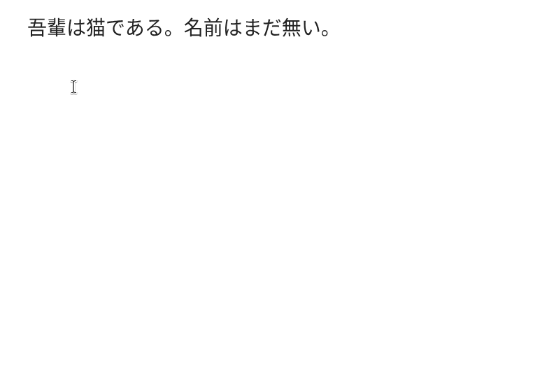
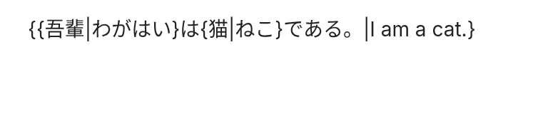

<h1 align="center">JADOU</h1>

  
  
  

JADOU is an evolving, all-in-one Japanese-language toolbox created by a specialist in Japanese language and culture. It lets you render and edit ruby annotations on two separate layers, look up readings and meanings, insert furigana, build glossaries, and automatically select sentences. Everything runs locally, with no network access.

## Notable Features

### Code skipping

The plugin will render ruby in reading and editing mode but show raw markup in source mode. Ruby in code blocks or inline code will not render or transform.

### Smart arrow keys

If smart arrow keys are enabled, the cursor will jump over ruby without revealing the raw markup. Press the arrow key in the opposite direction after a jump to edit the skipped text. You can disable smart arrow keys in the settings if you prefer to reveal the raw markup on cursor contact.

### Style settings

Native style settings lets you customize the rendering to your liking.

### Syntax conversion

Convert between Markdown and HTML ruby syntaxes.

### Other

- Glossary panel
- Support for looking up inflected word forms
- Mobile support
- PDF support
- One-click/hotkey-binded sentence selection

## How to Use

- Select a Japanese expression _containing kanji_ and trigger the lookup command to open the dictionary panel. You can use the ribbon icon, the command panel, a keyboard shortcut, or the editor’s context menu to do this.
- The “common,” “rare,” “irregular,” and “outdated” tags next to the entries refer to the kana usage / readings. These guide you toward the most context-appropriate bundle.
- Select an entry and press <kb>Enter</kb>, or click it, to add it to your glossary.
- Drag around entries inside the glossary to reorder them.
- Drop an entry into the editor to copy it.
- Use the Sort button to reorder entries in Japanese alphabetical order.
- Right‑click an entry to remove it from the glossary.
- Press <kb>Space</kb> or right‑click an entry in the dictionary panel to insert furigana instead of adding it to the glossary.

# Installing

Refer to [https://obsidian.md/help/community-plugins](https://obsidian.md/help/community-plugins).

## Security

- This plugin has zero run-time dependency.
- JADOU requires an internet connection only to download or update its dictionary data. It operates entirely offline otherwise and does not transmit or store your personal information.

## Roadmap

### Coming

- Support for traditional kanji forms.
- Text normalizer.
- Show whitespace

### Planned

- Kana-only lookup support.
- Saving/loading/attaching glossaries.

## Licenses & Acknowledgments

JADOU is available under the PolyForm-Perimeter v.1.0.1 license. Copyright (c) 2026 Peter Yanase

This project includes code derived from:

- Obsidian Sample Plugin (https://github.com/obsidianmd/obsidian-sample-plugin), licensed under the OBSD License. Copyright (c) 2020-2025 by Dynalist Inc.
- Obsidian Web Worker Example (https://github.com/RyotaUshio/obsidian-web-worker-example), licensed under the MIT License. Copyright (c) 2023 Ryota Ushio.
- Markdown Furigana Plugin (Obsidian) (https://github.com/steven-kraft/obsidian-markdown-furigana), licensed under the MIT License. Copyright (c) 2021-2023 Steven Kraft.
- Obsidian Furigana (https://github.com/uonr/obsidian-furigana), licensed under the MIT License. Copyright (c) 2021-2026 Koppa.
- Japanese Novel Ruby Plugin for Obsidian (https://github.com/k-quels/japanese-novel-ruby), licensed under the MIT License. Copyright (c) 2024-2025 quels <@k-quels>.
- Mahgen Renderer (https://github.com/MichaelFW-ui/mahgen-renderer), licensed under the MIT License. Copyright (c) 2024-2026 Michael Francis Williams.
- Obsidian Outliner (https://github.com/vslinko/obsidian-outliner), licensed under the MIT License. Copyright (c) 2021-2026 by Viacheslav Slinko.
- Advanced Ruby (https://github.com/peter-yanase/obsidian-advanced-ruby), licensed under the PolyForm-Perimeter v.1.0.1 license. Copyright (c) 2025–2026 Peter Yanase

This software uses data derived from the JMdict/EDICT dictionary files, licensed under the CC-BY-SA-4.0 License. Copyright (c) 2000 Electronic Dictionary Research and Development Group.

This software uses data derived from the SudachiDict (https://github.com/WorksApplications/SudachiDict) dictionary files, licensed under the Apache License, Version 2.0. Copyright (c) 2017-2023 Works Applications Co., Ltd.

This software uses a file from jmdict-simplified (https://github.com/scriptin/jmdict-simplified), licensed under the CC-BY-SA-4.0 License. Copyright (c) 2017-2026 Dmitry Shpika.

The furigana insertion logic was inspired by the implementation in kuroshiro (https://github.com/hexenq/kuroshiro), licensed under the MIT License. Copyright (c) 2015-2021 Hexen Qi.

Further licenses acknowledged in the dependencies are abbreviated here.
